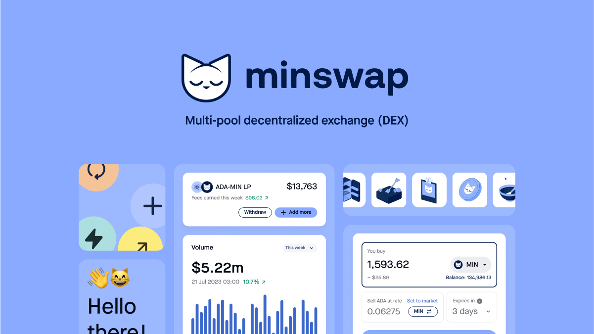

# Introduction

<figure><figcaption></figcaption></figure>

Minswap is a Decentralized Exchange (DEX). The purpose of a DEX is to enable permissionless trading of token pairs. For each swap, a fee is taken, which goes to the Liquidity Providers (LPs). Anyone can provide Liquidity as well, hence profits are decentralized. Minswap is a community-centric DEX, in that $MIN tokens are fairly distributed, without any private or VC investment. Minswap has pioneered several ideas in the Cardano ecosystem such as a focus on [Protocol Owned Liquidity](governance/dao-treasury-pol.md).

## Features

* **Community First:** MIN tokens are distributed fairly to protocol participants and Liquidity Providers, who can participate in [governance](https://forum.minswap.org/) and vote democratically on protocol changes.
* **Permissionless Listing:** Minswap is permissionless, meaning anybody can list tokens without needing KYC. See [Token Listing & Verification](for-projects/token-listing-and-verification.md).
* **Stake Pool Operators Support:** Minswap supports SPOs with a community-oriented ADA delegation policy, incentivizing SPOs in our batching solution [Laminar](https://medium.com/minswap/introducing-laminar-an-eutxo-scaling-protocol-for-accounting-style-smart-contract-d1ac8847dde8), and by enabling automatic native token fees conversion (Babel Fees).

## Achievements

* **Q2 2021:** Successfully received funds in [Catalyst Fund 5](https://drive.google.com/file/d/1Wp4ypNhssUwOBC9SLkxKgtyJaZ2h0fwl/view), commenced research on constant-product pool, completed [Plutus Pioneer Program](https://testnets.cardano.org/en/plutus-pioneer-program/).
* **Q3 2021:** Deployed Minswap testnet and gathered invaluable [feedback](https://medium.com/minswap/minswap-testnet-reflections-64b01c5e7c45).
* **Q4 2021:** Published Minswap´s solution to concurrency, [Laminar](https://minswap-labs.medium.com/introducing-laminar-an-eutxo-scaling-protocol-for-accounting-style-smart-contract-d1ac8847dde8), which aims to execute accounting-style smart contracts multiple times in one block.
* **Q1 2022:** After completion of a[ Security Audit by Tweag](https://minswap-labs.medium.com/minswap-announces-audit-completion-by-tweag-79a2910b98a), Minswap launched on Mainnet.
* **Q2 2022:** Minswap embraced research in [profit sharing](https://minswap-labs.medium.com/minomics-research-part-1-exploring-tokenomic-models-and-revenue-sources-dd59c434e38f) and further innovations around a new type of Emissions Schedule. Introduced features such as [distributing $ADA staking rewards to LPs](https://twitter.com/MinswapDEX/status/1541803084879462400?s=20\&t=C2YA8vWM66zeKhnQW4mgxA).
* **Q3 2022:** [Several improvements](https://twitter.com/MinswapDEX/status/1588131695206834176?s=20) were made on the UI/UX such as TradingView chart.
* **Q4 2022:** [Minswap DAO Governance](governance/README.md) was first implemented and the [Fee Switch](earn/min-staking/README.md) was introduced. Minswap Monthly Stats were introduced.
* **Q1 2023:** [Yield Farming V2](https://twitter.com/MinswapDEX/status/1615213160297889794?s=20) was introduced with multiple token harvest, utilizing the advantages of Plutus V2. Verification of tokens was introduced to protect Minswap users. Several milestones were achived such as [265$ $USD Cumulative Volume](https://twitter.com/MinswapDEX/status/1623322182670508034?s=20). 1 Year Mainnet Anniversary.
* **Q2 2023:**[ Minswap DAO Treasury Dashboard](https://minswap.org/pol/) was introduced. The "meme coin mania" struck Cardano, catapulting the Trading Volume on Minswap and reaching a record of 60.69mn $ADA Daily Trading Volume and [537mn $ADA for the month](https://x.com/MinswapDEX/status/1663960345294012425?s=20). A [Minswap DAO Emissions and Treasury Report](https://minswap.org/minswap-dao-emissions-and-treasury-report/) was authored by volunteers to look into $MIN emissions efficiency. A [vote](https://x.com/MinswapDEX/status/1676272036807680003?s=20) was passed to decide how LP $ADA would be delegated.
* **Q3 2023:** An [Emissions Range Ajustment Proposal was passed](https://x.com/MinswapDEX/status/1676964352224788484?s=20) after which [$MIN emissions steadily declined](https://x.com/MinswapDEX/status/1712485733519458658?s=20). 3 Catalyst Proposals were submitted and awarded with funding for: [an open-source Stableswap](https://x.com/MinswapDEX/status/1675890670723055623?s=20), [an open-source LBE V2](https://x.com/MinswapDEX/status/1677319557881446401?s=20), [the audit of Minswap V2.](https://x.com/MinswapDEX/status/1679127937348517888?s=20) [$MINomics V2](https://x.com/MinswapDEX/status/1682360201293201410?s=20) was announced and a vote was conducted to use [$ADA from the Fee Switch to reward $MIN Stakers](https://x.com/MinswapDEX/status/1693620191417020830?s=20). It was voted to use $ADA from Minswap Liquidity Providers [to vote in Catalyst](https://x.com/MinswapDEX/status/1701604662984778213?s=20) by having $MIN holders decide on the Top 20 Proposals.
